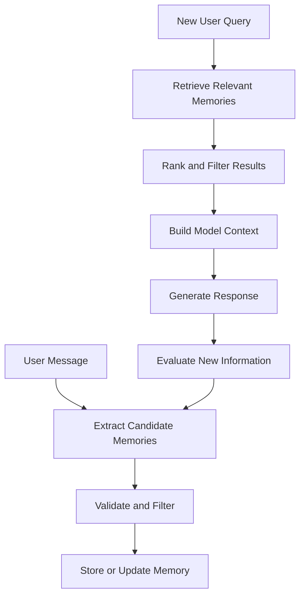
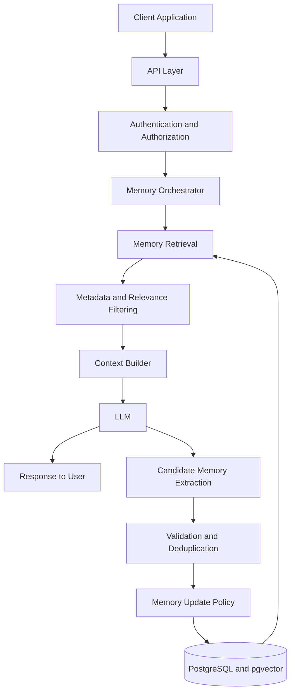

## Introduction

Large Language Models (LLMs) are remarkably good at understanding context, reasoning about information, and generating human-like responses. However, there is a fundamental limitation: an LLM does not automatically remember everything from previous conversations.

Consider a simple example.

You tell an AI assistant:

> I am building a project using Next.js and Prisma. I prefer TypeScript over JavaScript, and I want concise technical explanations.

A few days later, you start a new conversation and ask:

> Help me design the database for my project.

Ideally, the assistant should remember your technology stack and communication preferences without requiring you to repeat them.

But how can an AI system achieve this?

The answer is **LLM memory**.

LLM memory is the collection of mechanisms that allow an AI application to retain, organize, retrieve, and update information beyond the immediate context of a single model call.

It is one of the most important building blocks of modern AI agents because it enables personalization, continuity, learning from previous interactions, and more informed decision-making.

In this article, we will explore how LLM memory works, the different types of memory, memory storage and retrieval strategies, popular architectures, implementation approaches, and the challenges involved in building reliable memory systems.

---

## 1. Understanding the Context Window

Before exploring memory, we need to understand the context window.

The context window is the amount of information a model can process in a single invocation. It can contain:

- System instructions
- User messages
- Previous conversation messages
- Tool calls and tool responses
- Retrieved documents and memories
- Other information provided to the model

This information is represented as tokens, which are the units of text processed by the model.

For example, imagine a conversation containing 100 messages. If the application sends all 100 messages to the model on every request, the conversation history consumes part of the available context window.

As the conversation grows, this approach becomes increasingly expensive and eventually encounters context limits.

More importantly, including every previous message is not always useful. A conversation may contain temporary questions, outdated preferences, irrelevant details, and repeated information.

The solution is not simply to provide a larger context window. It is to build a system that decides what information should be retained and what information should be retrieved when needed.

### Context versus memory

These concepts are related, but they are not identical.

| Context | Memory |
|---|---|
| Information available to the model during a particular invocation | Information retained or managed for potential future use |
| Usually assembled for the current task | Can persist across requests and sessions |
| May contain complete conversation history | Usually contains selected facts, summaries, experiences, or state |
| Limited by the model's context window | Can use external storage with different capacity limits |
| Directly influences the current response | Influences future responses when relevant information is retrieved |

**The key distinction:** Memory is not necessarily information the model is currently aware of. It is information the surrounding system can preserve and bring back into context when required.

An application may have a database containing thousands of memories, while the model receives only three relevant memories for a particular question.

That is the foundation of a practical LLM memory system.

---

## 2. The Different Types of LLM Memory

Human memory provides a useful analogy for designing AI memory systems. Although artificial memory does not work exactly like biological memory, these categories help us understand different requirements.

A common classification includes working memory, episodic memory, semantic memory, and procedural memory.

### 2.1 Working Memory

Working memory contains the information needed to complete the current task.

In an AI application, this may include:

- The current conversation
- The user's immediate instructions
- Intermediate reasoning results
- Tool outputs
- Current task status
- Temporary variables and observations

Consider an AI coding agent asked to debug an application.

During the task, it might need to remember:

- Which files it has inspected
- Which errors it has discovered
- Which changes it has attempted
- Which tests have passed
- What it needs to investigate next

This information is relevant to the current task but may not need to be preserved permanently.

Working memory is often implemented through conversation messages, agent state, temporary storage, or framework checkpoints.

**Important:** A conversation history is not automatically a complete working-memory architecture. A production agent may also need explicit task state, intermediate results, and context-management logic.

### 2.2 Episodic Memory

Episodic memory stores information about specific past events or interactions.

Instead of storing only general facts, it captures what happened, when it happened, and what the outcome was.

For example:

> On October 10, the user attempted to deploy a Next.js application. The deployment failed because an environment variable was missing. After adding the variable, the deployment succeeded.

This memory can help the assistant when a related deployment problem appears in the future.

Episodic memory can be useful for:

- Remembering previous conversations
- Tracking completed tasks
- Learning from successful and unsuccessful attempts
- Maintaining project history
- Recalling previous decisions
- Supporting long-running workflows

An episodic memory record might contain:

```json
{
  "type": "episodic",
  "event": "Next.js deployment failed",
  "cause": "Missing environment variable",
  "resolution": "Added the missing environment variable",
  "timestamp": "2026-10-10",
  "project": "web-application"
}
```

The timestamp, event, and outcome help the system distinguish this experience from other events.

### 2.3 Semantic Memory

Semantic memory contains facts, concepts, and information that can be reused across different situations.

For example:

- The user prefers TypeScript.
- The application uses PostgreSQL.
- The project uses Prisma ORM.
- The user prefers detailed technical explanations.
- A particular API requires authentication.

Unlike episodic memory, semantic memory does not necessarily need to preserve the original conversation in which a fact appeared.

A memory extraction process might convert several conversations into one consolidated record:

```json
{
  "type": "semantic",
  "subject": "web-application",
  "facts": {
    "framework": "Next.js",
    "language": "TypeScript",
    "orm": "Prisma",
    "database": "PostgreSQL"
  }
}
```

Semantic memory is particularly useful for personalization, project context, and factual retrieval.

However, facts can become outdated. A robust system should track when information was learned, how reliable it is, and whether newer information supersedes it.

### 2.4 Procedural Memory

Procedural memory represents how to perform a task.

For AI agents, it can include reusable workflows, instructions, strategies, and learned procedures.

For example, an agent might use the following deployment procedure:

1. Install dependencies.
2. Run linting and type checks.
3. Execute automated tests.
4. Build the application.
5. Verify required environment variables.
6. Deploy the application.
7. Check the deployment logs.

If the agent repeatedly performs a task, the application can preserve a reliable procedure rather than reconstructing the entire workflow every time.

Procedural memory can be implemented using:

- Saved workflows
- Reusable tool instructions
- Skills and playbooks
- Code templates
- Successful action sequences
- Explicit policies and procedures

A critical distinction is that storing a procedure is not the same as training the model's weights. An application can retrieve and execute a saved workflow without changing the underlying model.

### Comparing the four types

| Memory type | Main question | Example |
|---|---|---|
| Working | What do I need right now? | Current debugging state |
| Episodic | What happened before? | Previous deployment failure |
| Semantic | What facts do I know? | Project uses PostgreSQL |
| Procedural | How should I do this? | Deployment checklist |

These categories are conceptual tools rather than universal standards. Different frameworks and research papers may use slightly different definitions or introduce additional categories.

---

## 3. How an LLM Memory System Works

A practical memory system needs more than a database. It needs a lifecycle for deciding what to remember and how to use it.

A typical lifecycle looks like this:



This workflow has several important stages.

### Step 1: Extract candidate memories

The system examines the interaction and identifies potentially useful information.

For example:

> I usually work with Next.js and PostgreSQL, and I prefer examples written in TypeScript.

The extraction process might produce three candidate facts:

- Preferred framework: Next.js
- Preferred database: PostgreSQL
- Preferred language for examples: TypeScript

Not every sentence should become a memory. A question about a temporary topic may not be useful in future conversations.

### Step 2: Validate and filter

Before storing a candidate, the system should determine:

- Is this information useful in future interactions?
- Is it already stored?
- Is it temporary or likely to change?
- Is it sufficiently reliable?
- Does it contradict an existing memory?
- Is it sensitive information that should not be retained?
- Does the application have permission to store it?

For example, if a user says, "Use Python for this example," that does not necessarily mean Python is their permanent language preference.

Memory extraction should distinguish instructions for the current task from durable preferences.

### Step 3: Store or update the memory

Once validated, a memory can be stored in an appropriate format.

Some information belongs in structured records. Other information may be better represented as text, a vector embedding, or a relationship between entities.

The storage design should match the information being retained and how it will be retrieved later.

### Step 4: Retrieve relevant memories

When a new question arrives, the system searches its memory store for information that could help answer it.

For example:

> How should I structure my backend?

The retrieval system might return:

- The user is building with Next.js.
- The project uses PostgreSQL.
- The user prefers TypeScript.
- The project already uses Prisma.

Unrelated memories about music preferences or previous travel plans should not be included.

### Step 5: Inject memories into the context

Retrieved memories are formatted and included in the prompt or agent state.

For example:

```text
Relevant user context:
- Framework: Next.js
- Language: TypeScript
- Database: PostgreSQL
- ORM: Prisma

Current task:
Recommend a maintainable backend structure.
```

The model can now produce a more relevant answer without receiving the entire history of previous conversations.

### Step 6: Learn from new interactions

After completing the task, the system may extract additional information, update an existing memory, or record the outcome of the interaction.

This creates a continuous cycle of memory management.

However, the system should not blindly treat every model-generated statement as a fact. Candidate memories need validation, provenance, and appropriate update rules.

---

## 4. Where Should LLM Memories Be Stored?

Different types of memory require different storage strategies.

### 4.1 Relational databases

Databases such as PostgreSQL are useful for structured memories.

For example:

```sql
CREATE TABLE memories (
    id UUID PRIMARY KEY,
    user_id UUID NOT NULL,
    memory_type TEXT NOT NULL,
    content TEXT NOT NULL,
    source TEXT,
    created_at TIMESTAMPTZ DEFAULT NOW(),
    updated_at TIMESTAMPTZ DEFAULT NOW()
);
```

This table can store facts, preferences, task records, and other memory entries.

Relational databases are useful when you need:

- User-level isolation
- Metadata filtering
- Reliable updates
- Transaction support
- Explicit relationships
- Auditability

You can also use PostgreSQL with the `pgvector` extension to support vector similarity search alongside ordinary SQL queries.

### 4.2 Vector databases

Vector databases store embeddings: numerical representations of text or other data that support similarity-based retrieval.

A simplified workflow is:

1. Convert a memory into text.
2. Generate an embedding using an embedding model.
3. Store the embedding alongside the memory and metadata.
4. Embed the incoming query.
5. Search for nearby vectors.
6. Return the most relevant memories.

For example, these sentences have related meanings:

- "The user prefers concise answers."
- "Keep responses short and direct."

A vector search system may recognize their semantic similarity even though their wording differs.

Popular options include:

- PostgreSQL with pgvector
- Qdrant
- Pinecone
- Weaviate
- Chroma

A vector database is not mandatory for every memory system. If an application only needs to retrieve a few structured user preferences, a conventional database may be sufficient.

### 4.3 Document stores

Document-oriented databases can store flexible memory records containing text, metadata, timestamps, and nested objects.

They are useful when different memories have different structures or when the application needs to preserve conversation summaries and event records.

### 4.4 Knowledge graphs

Knowledge graphs represent entities and their relationships.

For example:

```text
User
 ├── prefers_language → TypeScript
 ├── works_on → Quiz Application
 └── prefers_framework → Next.js

Quiz Application
 ├── uses_database → PostgreSQL
 └── uses_orm → Prisma
```

This structure helps an agent understand how information is connected.

Knowledge graphs can be especially useful when queries require multi-hop relationships, such as determining which database belongs to a particular project.

### Choosing a storage approach

| Storage approach | Best use case |
|---|---|
| Relational database | Structured facts and reliable updates |
| Vector search | Semantic retrieval from large memory collections |
| Document store | Flexible records and conversation summaries |
| Knowledge graph | Entity relationships and multi-hop queries |
| Hybrid architecture | Applications requiring multiple retrieval methods |

In production systems, these approaches are often combined rather than used exclusively.

---

## 5. Memory Retrieval: Finding the Right Information

Storing memories is only half the problem. The system must retrieve the right memories at the right time.

A poor retrieval strategy can cause an agent to ignore useful information or inject irrelevant facts into the prompt.

### 5.1 Semantic retrieval

Semantic retrieval compares embeddings of a query and stored memories.

Suppose the query is:

> What technology stack am I using?

The system might retrieve a memory saying:

> The application uses Next.js, TypeScript, Prisma, and PostgreSQL.

Even if the memory does not contain the exact words "technology stack," semantic similarity can help identify it.

### 5.2 Keyword retrieval

Keyword retrieval searches for exact terms or lexical matches.

This is useful when the query includes:

- A project name
- A function or class name
- A specific error message
- A technical identifier
- A precise product or API name

Keyword retrieval can be implemented using SQL search, full-text search, or a search engine.

### 5.3 Hybrid retrieval

Hybrid retrieval combines semantic similarity with keyword-based search.

For example, a query about a specific PostgreSQL error may benefit from both semantic matching and exact matching of the error code.

A hybrid system can:

1. Retrieve candidates using vector similarity.
2. Retrieve additional candidates using keyword search.
3. Combine the results.
4. Remove duplicates.
5. Rerank candidates.
6. Return the most relevant memories.

Hybrid retrieval is often more robust than relying exclusively on one search technique.

### 5.4 Reranking

Initial retrieval produces candidate memories. A reranker evaluates those candidates against the query and orders them by relevance.

For example, the retrieval system may find 20 memories, but only the top five are needed.

Reranking helps the application prioritize the most useful information before constructing the final context.

### 5.5 Recency and temporal relevance

Some memories become less useful over time.

Consider two records:

- Six months ago: The project used MongoDB.
- Yesterday: The project migrated to PostgreSQL.

A retrieval system should not treat these facts as equally current.

Useful metadata can include:

- Creation time
- Last confirmation time
- Validity period
- Source of the information
- Confidence
- Superseded status

Recency should not automatically override everything else, however. A historical event may remain important even after it becomes old.

A good retrieval strategy considers both temporal relevance and the nature of the memory.

---

## 6. How Should an Agent Decide What to Remember?

One of the hardest parts of memory engineering is deciding what deserves to be stored.

If an agent stores every sentence, memory grows rapidly. It becomes harder to retrieve useful facts, storage costs increase, and irrelevant information can reduce answer quality.

If the agent stores too little, it repeatedly asks users for information they have already provided.

The goal is selective retention.

### A practical memory scoring model

You can design a heuristic that considers several dimensions:

- **Utility:** How likely is this information to help with future tasks?
- **Durability:** How long is the information likely to remain relevant?
- **Confidence:** How reliable is the source?
- **Recurrence:** Has the information been confirmed more than once?
- **Specificity:** Is the information precise enough to be useful?

For example, a simple conceptual score could be:

```text
Memory Score =
    0.35 × Utility
  + 0.25 × Durability
  + 0.20 × Confidence
  + 0.10 × Recurrence
  + 0.10 × Specificity
```

Each dimension could be normalized between 0 and 1.

These weights are illustrative, not a universal formula. A real application should tune its criteria to its use case and evaluate whether the resulting memories improve performance.

### Examples of memory decisions

| Information | Suggested action | Reason |
|---|---|---|
| "I prefer TypeScript examples." | Store as a preference | Likely to be useful repeatedly |
| "Use Python for this calculation." | Usually keep in task context | May apply only to the current task |
| "The deployment failed due to a missing variable." | Store if relevant to ongoing work | Useful project history |
| "My current task is fixing a build error." | Keep in working memory | Temporary task state |
| "I changed the database to PostgreSQL." | Update project memory | New information supersedes old state |

Memory retention should also respect user expectations, data-minimization principles, and applicable privacy requirements.

---

## 7. Memory Consolidation and Updating

A long-running agent may accumulate many memories describing the same topic.

For example:

1. The user is learning React.
2. The user is building a React application.
3. The user is exploring Next.js.
4. The user has migrated a project to Next.js.

Keeping every record as an independent, equally current fact can create confusion.

Memory consolidation reduces redundancy and organizes related information into a more useful representation.

### A practical consolidation workflow

1. Retrieve existing memories related to the new information.
2. Determine whether the new information adds a fact, corrects a fact, or contradicts a fact.
3. Preserve important historical events.
4. Update the current state when the new information is sufficiently reliable.
5. Merge duplicates where appropriate.
6. Record provenance and timestamps.
7. Re-index the updated memory if necessary.

For example:

```text
Old memory:
The project uses React.

New information:
The project has migrated to Next.js.

Updated project state:
The project uses Next.js.

Historical record:
The project previously used React before migration.
```

Notice that the historical record is not necessarily deleted. The current project state and the history of how it evolved serve different purposes.

### Handling contradictions

Suppose a user says:

> My project uses MongoDB.

Later, they say:

> We migrated the database to PostgreSQL.

The memory system should not simply retrieve both statements without context.

It should determine whether the later statement represents a migration, a different project, or a correction.

A robust system can maintain:

- The current value
- Previous values
- Source messages
- Timestamps
- Confidence
- Validity intervals

When the evidence is ambiguous, the agent should ask for clarification instead of inventing certainty.

### Forgetting and expiration

Not every memory should remain indefinitely.

Some records should expire automatically, while others should remain until explicitly updated or deleted.

For example:

- A temporary task state may expire when the task finishes.
- A project preference may remain until the project changes.
- A historical event may be retained for audit or continuity purposes.
- Sensitive information may require stricter retention rules or should not be stored at all.

Memory expiration and deletion should be explicit parts of the system design, not afterthoughts.

---

## 8. RAG vs. LLM Memory

Retrieval-Augmented Generation (RAG) and LLM memory often use similar infrastructure, including embeddings, vector search, and external storage.

However, their goals are different.

### What is RAG?

RAG retrieves relevant information from an external knowledge source and provides it to the LLM to generate a grounded response.

For example, a company assistant may retrieve passages from documentation, product manuals, and internal policies.

### What is LLM memory?

LLM memory focuses on information that should be retained or reused across interactions, tasks, or agent executions.

For example, a personal assistant may remember a user's preferences, past decisions, ongoing projects, and previous task outcomes.

| Dimension | RAG | LLM memory |
|---|---|---|
| Primary goal | Retrieve useful knowledge | Preserve and reuse relevant information |
| Typical source | Documents, knowledge bases, external datasets | Conversations, experiences, profiles, task state |
| Updates | Often follows document ingestion or synchronization | May update continuously after interactions |
| Personalization | Possible | Often a central requirement |
| Retrieval methods | Keyword, vector, hybrid search | Keyword, vector, hybrid, structured lookup |
| Shared infrastructure | Often uses databases and embeddings | Can use the same infrastructure |

The distinction is not absolute. RAG can retrieve user-specific information, and memory systems can retrieve documents.

The more useful distinction is the purpose of the information and the rules governing its retention, updating, and retrieval.

---

## 9. MemGPT: Treating Memory Like an Operating System

One influential research direction is MemGPT, which explores how an LLM can manage information across different memory levels despite a limited context window.

The central idea is to treat the context window as a limited resource rather than the entire memory system.

An agent can use tools and explicit control mechanisms to move information between the active context and external storage.

Conceptually, this resembles an operating system managing limited working memory and larger storage.

### The main idea

Imagine an agent working on a complex software project.

It cannot keep every source file, log, conversation, and decision in its active context at once.

Instead, it can:

1. Keep the current task and most relevant facts in active context.
2. Store additional information externally.
3. Retrieve specific information when it becomes necessary.
4. Summarize or reorganize information when the context becomes crowded.
5. Update persistent records as the project evolves.

This architecture is particularly relevant for agents that operate over long periods or work with large collections of information.

### Further reading

- [MemGPT research paper](https://arxiv.org/abs/2310.08560)
- [Letta documentation](https://docs.letta.com/)

MemGPT is a research architecture, and Letta is a related agent platform that develops ideas around persistent, tool-managed memory.

---

## 10. Mem0: A Practical Memory Layer for AI Applications

Mem0 is an example of a dedicated memory layer designed to help applications preserve and retrieve information across interactions.

Instead of implementing every memory-management operation from scratch, developers can integrate a memory system that supports adding, searching, and managing memories.

A simplified application flow looks like this:

```text
User message
     |
     v
Memory extraction
     |
     v
Memory management
     |
     v
Persistent storage

New user query
     |
     v
Memory search
     |
     v
Relevant memories
     |
     v
LLM response
```

A memory layer can help with:

- Extracting useful facts from interactions
- Retrieving memories for a new query
- Managing user-specific records
- Updating or deduplicating stored information
- Separating memory logic from application code

However, a memory framework does not eliminate the need to design access control, retention policies, evaluation, and data validation.

### Further reading

- [Mem0 documentation](https://docs.mem0.ai/)
- [Mem0 GitHub repository](https://github.com/mem0ai/mem0)

These resources are useful when moving from conceptual architecture to an actual implementation.

---

## 11. Implementing a Basic Memory System

Let's build a simplified memory implementation in Python.

This example demonstrates the core lifecycle without requiring a vector database or a complex agent framework.

It is intentionally small so that the underlying design remains clear.

### Step 1: Define a memory record

```python
from dataclasses import dataclass
from datetime import datetime, timezone
from typing import Optional
import uuid


@dataclass
class Memory:
    id: str
    user_id: str
    content: str
    memory_type: str
    created_at: str
    source: Optional[str] = None


def create_memory(
    user_id: str,
    content: str,
    memory_type: str = "semantic",
    source: Optional[str] = None,
) -> Memory:
    return Memory(
        id=str(uuid.uuid4()),
        user_id=user_id,
        content=content,
        memory_type=memory_type,
        created_at=datetime.now(timezone.utc).isoformat(),
        source=source,
    )
```

Each memory has an identifier, an owner, its content, a category, a timestamp, and an optional source.

In a production system, additional fields might include confidence, expiration, provenance, and version information.

### Step 2: Add a simple in-memory store

```python
class MemoryStore:
    def __init__(self):
        self.memories = []

    def add(self, memory: Memory):
        self.memories.append(memory)

    def get_user_memories(self, user_id: str):
        return [
            memory
            for memory in self.memories
            if memory.user_id == user_id
        ]
```

This implementation uses a Python list for simplicity.

It does not persist data after the program exits. A production implementation should use a persistent database and enforce access control at the storage layer.

### Step 3: Retrieve relevant memories

For a minimal demonstration, we can use keyword matching.

```python
def retrieve_memories(
    store: MemoryStore,
    user_id: str,
    query: str,
    limit: int = 5,
):
    memories = store.get_user_memories(user_id)
    query_terms = set(query.lower().split())

    scored = []

    for memory in memories:
        content_terms = set(memory.content.lower().split())
        score = len(query_terms & content_terms)

        if score > 0:
            scored.append((score, memory))

    scored.sort(key=lambda item: item[0], reverse=True)

    return [
        memory
        for _, memory in scored[:limit]
    ]
```

This example demonstrates retrieval, but keyword overlap is a very basic relevance measure. It does not understand synonyms, sentence meaning, or complex relationships.

For real applications, consider full-text search, embeddings, hybrid retrieval, or a dedicated retrieval framework.

### Step 4: Use retrieved memories in a prompt

```python
def build_context(query: str, memories: list[Memory]) -> str:
    memory_text = "\n".join(
        f"- {memory.content}"
        for memory in memories
    )

    return f"""
Relevant memories:
{memory_text or "- No relevant memories found."}

Current user question:
{query}

Answer the question using relevant memories when helpful.
If information is missing or uncertain, do not invent facts.
"""
```

Your application can send this context to an LLM API and use the returned response.

The important point is that the model does not need to receive the entire memory database. The application retrieves a small set of relevant records and builds the context for the current request.

### Step 5: Put the lifecycle together

```python
store = MemoryStore()

store.add(
    create_memory(
        user_id="user-123",
        content="The project uses Next.js and TypeScript.",
        memory_type="semantic",
    )
)

store.add(
    create_memory(
        user_id="user-123",
        content="The project database is PostgreSQL.",
        memory_type="semantic",
    )
)

query = "Which database does my project use?"

memories = retrieve_memories(
    store=store,
    user_id="user-123",
    query=query,
)

prompt = build_context(query, memories)

print(prompt)
```

This example is a teaching prototype, not a production-ready memory system. It lacks persistent storage, robust ranking, automatic fact extraction, update logic, and security controls.

Nevertheless, it illustrates the central architecture:

**Store information → Retrieve relevant information → Build context → Generate a response.**

---

## 12. Memory in Agentic Workflows

Memory becomes especially important when an LLM is part of an agentic workflow.

A simple LLM application may receive a question and generate a response. An agent, on the other hand, may repeatedly plan, call tools, observe results, and revise its actions.

For example, a coding agent may:

1. Inspect a repository.
2. Identify a failing test.
3. Read the relevant source files.
4. Modify the code.
5. Run the test again.
6. Analyze the result.
7. Continue until the task is complete.

Working memory maintains the current execution state, episodic memory records important outcomes, semantic memory preserves stable project facts, and procedural memory can store reusable workflows.

### Memory and the ReAct pattern

ReAct combines reasoning and acting through a loop in which an LLM determines actions and uses their observations to continue.

A simplified representation is:

```text
User request
     |
     v
Reason about the task
     |
     v
Select an action
     |
     v
Execute a tool
     |
     v
Observe the result
     |
     v
Update task context
     |
     +------> Continue if needed
```

ReAct does not inherently provide persistent long-term memory. Its reasoning-action loop can operate within one execution, while an external memory system preserves information across executions.

A more capable agent can combine the two:

```text
                 +-------------------+
                 | Persistent Memory |
                 +---------+---------+
                           |
                           v
User ---> Retrieve ---> Agent Loop ---> Response
                           |
                           v
                     New Experience
                           |
                           +----> Memory Update
```

This allows the agent to use past experiences without assuming that every previous interaction is still present in its context.

---

## 13. Challenges in Building Reliable Memory

Memory systems introduce several difficult engineering problems.

### 13.1 Incorrect memory extraction

An LLM may extract a fact that the user never explicitly stated or interpret a temporary instruction as a permanent preference.

**Possible solution:** Validate candidate memories, preserve source references, and distinguish explicit statements from inferred information.

### 13.2 Contradictory memories

The memory store may contain outdated facts alongside new information.

**Possible solution:** Track timestamps, versions, provenance, and explicit supersession relationships.

### 13.3 Retrieval noise

An agent may retrieve memories that are semantically similar but irrelevant to the current task.

**Possible solution:** Combine metadata filtering with retrieval, reranking, and relevance thresholds.

### 13.4 Memory bloat

Storing too much information increases storage and retrieval costs and can make the system harder to manage.

**Possible solution:** Deduplicate, summarize, consolidate, and expire memories according to explicit policies.

### 13.5 Privacy and data security

Persistent memory can contain personal information, confidential project details, or other sensitive content.

**Possible solution:** Apply data minimization, user-level access controls, encryption where appropriate, retention limits, and deletion mechanisms.

Never assume that storing data in a vector database makes it safe or grants permission to retain it.

### 13.6 Cross-user information leakage

A retrieval bug could expose one user's memories to another user.

**Possible solution:** Enforce tenant and user isolation in every retrieval and update path, not just in the application interface.

### 13.7 Latency and cost

Extraction, embedding generation, retrieval, and reranking can add latency and API costs.

**Possible solution:** Cache appropriate results, batch operations, avoid unnecessary memory searches, and select the least expensive approach that meets the quality requirements.

### 13.8 Evaluating memory quality

A memory system can appear to work in a few demonstrations while failing on long conversations or conflicting information.

**Possible solution:** Build a repeatable evaluation dataset containing questions about previous events, temporal changes, user preferences, and facts that should not be remembered.

---

## 14. How Do We Evaluate an LLM Memory System?

Evaluation should measure more than whether a memory was successfully saved.

A useful evaluation framework includes several dimensions.

| Metric | What it measures |
|---|---|
| Extraction accuracy | Whether the system identifies the correct information |
| Retrieval precision | How many retrieved memories are actually relevant |
| Retrieval recall | How many relevant memories are successfully found |
| Answer correctness | Whether the final answer correctly uses the available memories |
| Temporal consistency | Whether outdated facts are distinguished from current ones |
| Update accuracy | Whether changes and contradictions are handled correctly |
| Privacy compliance | Whether restricted information is protected and deleted appropriately |
| Latency and cost | How expensive and slow the memory lifecycle is |

Consider this example:

1. A user says that a project uses MongoDB.
2. Later, the user says that the project migrated to PostgreSQL.
3. The user then asks which database the project currently uses.

A successful memory system should answer PostgreSQL while retaining the historical fact that MongoDB was previously used, if that history is useful.

This single test examines temporal reasoning, memory updates, retrieval, and answer generation.

### Useful benchmarks

- [LongMemEval](https://github.com/xiaowu0162/LongMemEval) — evaluates long-term conversational memory, including information extraction, temporal reasoning, and knowledge updates.
- [LoCoMo](https://github.com/snap-research/locomo) — evaluates long-conversation memory and reasoning across dialogue histories.

Benchmarks are useful starting points, but production systems should also be tested against realistic examples from their intended use cases, with appropriate privacy protections.

---

## 15. A Practical Architecture for Production

For a real application, I would start with a relatively simple architecture and introduce complexity only when the requirements justify it.



### Recommended starting stack

- **Application:** Next.js with TypeScript
- **API layer:** Next.js route handlers or a dedicated backend
- **Persistent storage:** PostgreSQL
- **Semantic search:** pgvector
- **LLM:** A model API appropriate for the application's needs
- **Memory orchestration:** Custom logic initially, with LangGraph or a dedicated memory framework when useful

PostgreSQL and pgvector are a practical starting point because they let you manage structured records and semantic retrieval without operating multiple separate databases.

A production system should also implement:

- Authentication and authorization
- User and tenant isolation
- Memory provenance and timestamps
- Update and deletion workflows
- Retrieval logging
- Evaluation tests
- Monitoring for latency, failures, and cost

Start simple. Add a separate vector database, knowledge graph, or more complex consolidation pipeline only when you can identify a concrete requirement that the initial architecture cannot satisfy. 

## Conclusion

LLM memory is much more than saving conversation history or storing embeddings in a vector database.

A reliable memory system must decide what information is worth retaining, represent it in a useful form, retrieve it when relevant, update it when circumstances change, and protect it throughout its lifecycle.

Working memory helps an agent complete the current task. Episodic memory preserves experiences. Semantic memory stores reusable facts. Procedural memory captures workflows and methods.

Together with appropriate retrieval, storage, and update mechanisms, these capabilities allow AI applications to maintain continuity across conversations and tasks.

The most important design principle is this:

**A good memory system does not remember everything. It remembers the right things, retrieves them at the right time, and knows when they are no longer valid.**

As AI applications evolve from simple chat interfaces into agents that work across sessions and execute complex tasks, memory becomes a central part of their architecture—not just an optional feature.